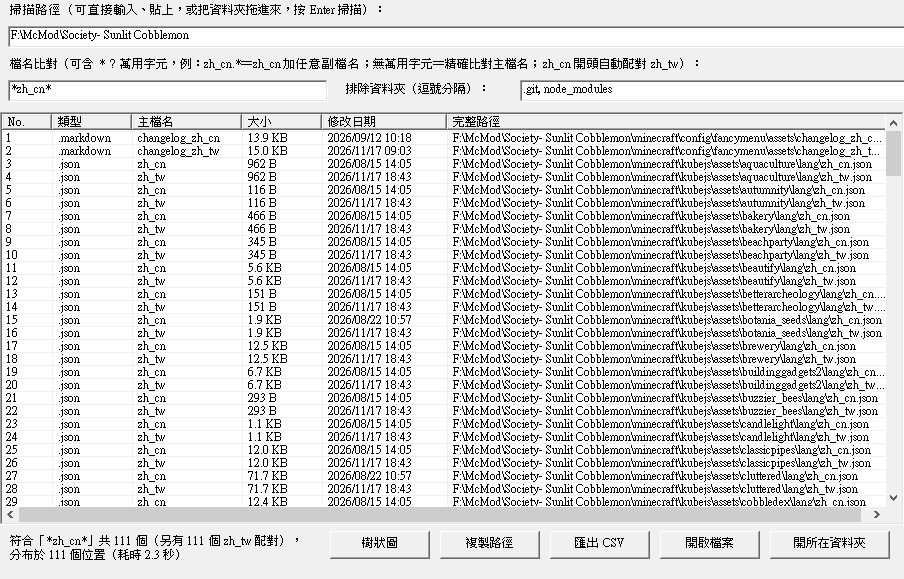

# MMCS - Minecraft Mod zh_cn Scanner

這是一個輕量化的 Windows PowerShell GUI 工具，遞迴掃描指定資料夾底下所有主檔名為 `zh_cn`（任何副檔名）的檔案與資料夾，列出完整路徑、大小與修改日期，並自動偵測同資料夾的 `zh_tw` 配對檔。主要用來快速找出 Minecraft 模組包中缺漏的語言檔位置，不會建立或修改任何檔案。

---

## 使用方式

1. **下載**：Code → Download ZIP（或 `git clone https://github.com/anku0910/MMCS_Minecraft-Mod-zh_ch-Scanner.git`）
2. **啟動**：雙擊 `MMCS.bat`
3. **輸入路徑**：直接打字（資料夾名稱自動補全）、貼上路徑，或把資料夾拖進視窗 / 拖到 `.bat` 上
4. **掃描**：按 Enter 或點「開始掃描」
5. **查看結果**：雙擊任一列＝開啟所在資料夾；選取後可「開啟檔案」、「複製路徑」、「匯出 CSV」

---

## 系統需求

- **Windows 10 / 11**
- 內建 **Windows PowerShell 5.1** 即可，無需安裝任何東西

---

## 主要功能

- **輕量化**：純 PowerShell 5.1 + GDI+，零相依、免安裝，約 30 KB
- **背景掃描**：Runspace 背景執行不卡 UI，即時顯示進度，可隨時取消
- **萬用字元比對**：支援 `*zh_cn*`、`zh_cn.*`、`zh_cn*`、`zh_cn`
- **zh_tw 配對偵測**：比對值含 `zh_cn` 時自動推導對應的 `zh_tw` 模式並一併列出
- **WizTree 風格樹狀圖**：點「樹狀圖」按鈕，以面積顯示檔案大小、顏色區分語系
- **排除資料夾**：預設跳過 `.git`、`node_modules`，可自行修改
- **記住設定**：路徑、比對值、排除清單、視窗位置大小會自動儲存

---

## 檔名比對語法

| 輸入 | 意義 | 範例 |
|------|------|------|
| `*zh_cn*` | 檔名任何位置含 `zh_cn`（預設值） | `my_zh_cn.json`、`zh_cn.txt`、`zh_cn`（無副檔名）、資料夾 `zh_cn` |
| `zh_cn.*` | `zh_cn` + 任意副檔名（不含無副檔名檔案與資料夾） | `zh_cn.json`、`zh_cn.md` |
| `zh_cn*` | 主檔名以 `zh_cn` 開頭 | `zh_cn_backup.json`、`zh_cn_extra.md` |

比對值包含 `zh_cn` 時，會自動把 `cn` 換成 `tw` 推導對應的 `zh_tw` 模式（`*zh_cn*` → `*zh_tw*`、`zh_cn` → `zh_tw`、`zh_cn.*` → `zh_tw.*`）。

---

## 樹狀圖（WizTree 風格）

掃描後點「樹狀圖」按鈕：

- **面積 = 檔案大小**，哪個資料夾、哪個檔案佔最多空間一目了然
- **顏色 = 語系**：綠藍 `zh_cn`、橘 `zh_tw`、灰「其他」
- 外層容器是資料夾，內層是個別檔案；滑鼠停留顯示完整路徑與大小

---

## 排除資料夾

預設排除 `.git`、`node_modules`（不遞迴進入）。可輸入逗號分隔的資料夾名稱清單自訂，設定會自動保存到 `MMCS.settings.json`。比對值、路徑、排除清單會記住你上次輸入，下次開啟還是那個值——若想改回 `*zh_cn*` 預設，請把比對欄改成 `*zh_cn*` 掃描一次即可。

---

## 檔案說明

| 檔案 | 說明 |
|------|------|
| `MMCS.bat` | 啟動器（雙擊入口，內容純 ASCII 避免編碼問題） |
| `MMCS.ps1` | 主程式（PowerShell WinForms GUI，UTF-8 with BOM） |
| `MMCS.settings.json` | 執行後自動產生的個人設定（不會上傳） |
| `Pic1.png` | 介面示範圖片 |
